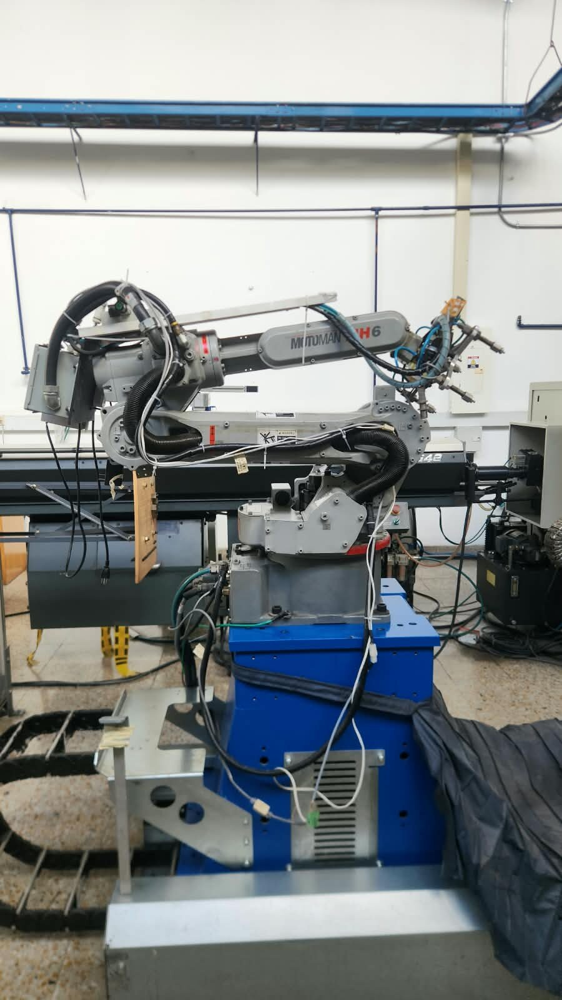
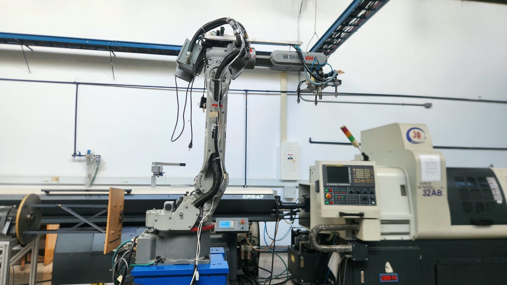
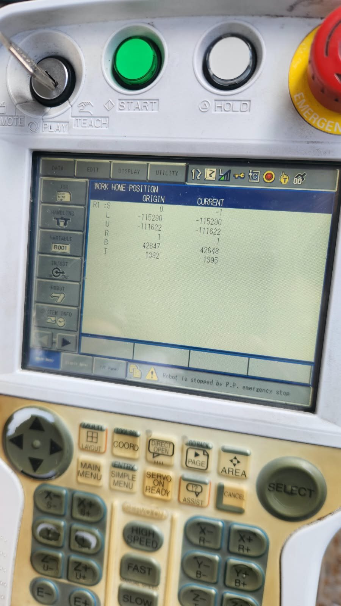
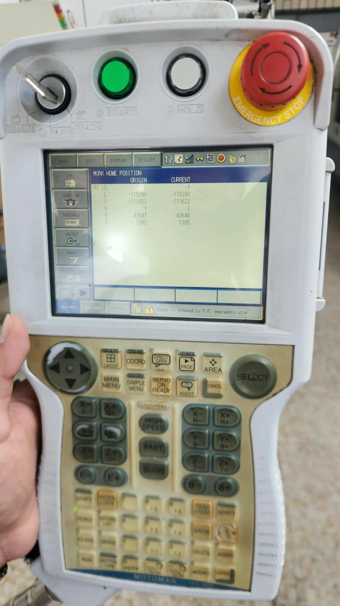
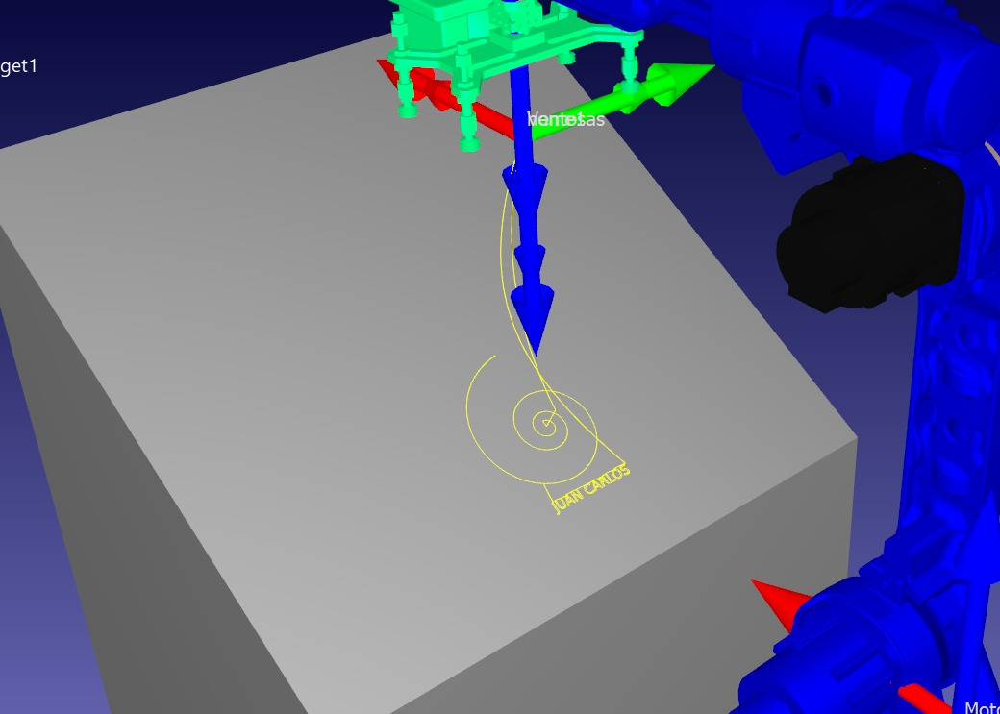
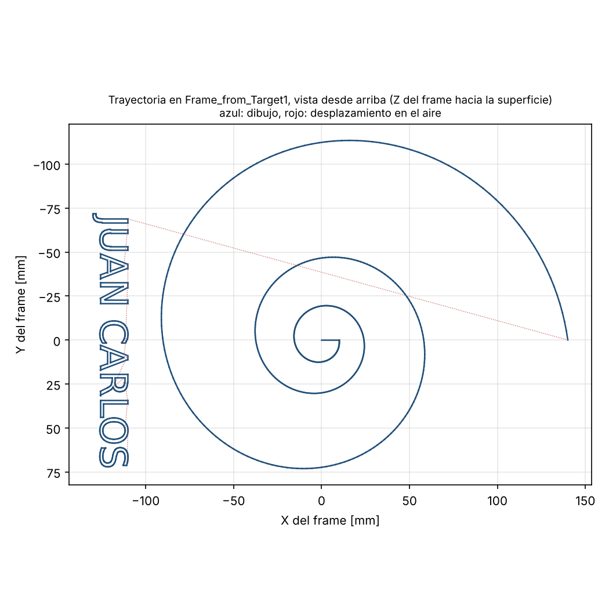
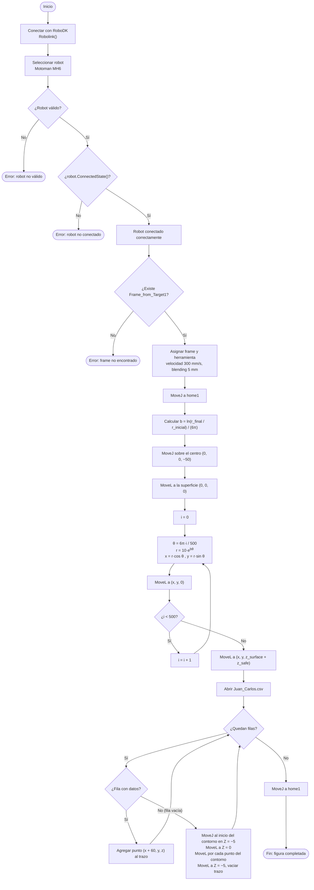
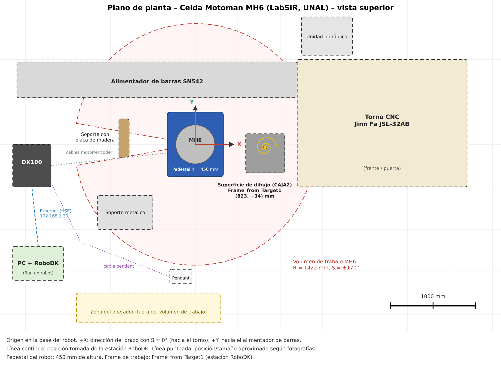

# Laboratorio No. 02 – Robótica Industrial: Análisis y Operación del Manipulador Motoman MH6

**Universidad Nacional de Colombia – Sede Bogotá · LabSIR · Robótica 2026-I**

| Integrantes | GitHub |
|---|---|
| Juan Diego Ruiz Trejo | [@Jruiztr28](https://github.com/Jruiztr28) |
| Carlos Guzmán Sandoval | [@carlosguzmans](https://github.com/carlosguzmans) |

---

## Contenido

1. [Cuadro comparativo Motoman MH6 vs. ABB IRB 140](#1-cuadro-comparativo-motoman-mh6-vs-abb-irb-140)
2. [Configuraciones Home1 y Home2 del Motoman MH6](#2-configuraciones-home1-y-home2-del-motoman-mh6)
3. [Movimientos manuales con el teach pendant](#3-movimientos-manuales-con-el-teach-pendant)
4. [Niveles de velocidad en movimiento manual](#4-niveles-de-velocidad-en-movimiento-manual)
5. [RoboDK: aplicaciones y comunicación con el manipulador](#5-robodk-aplicaciones-y-comunicación-con-el-manipulador)
6. [Comparación RoboDK vs. RobotStudio](#6-comparación-robodk-vs-robotstudio)
7. [Trayectoria polar: espiral logarítmica](#7-trayectoria-polar-espiral-logarítmica)
8. [Diagrama de flujo de acciones del robot](#8-diagrama-de-flujo-de-acciones-del-robot)
9. [Plano de planta](#9-plano-de-planta)
10. [Código (anexo)](#10-código-anexo)
11. [Videos](#11-videos)
12. [Estructura del repositorio](#12-estructura-del-repositorio)

---

## 1. Cuadro comparativo Motoman MH6 vs. ABB IRB 140

| Característica | Yaskawa Motoman MH6 | ABB IRB 140 |
|---|---|---|
| Fabricante | Yaskawa (Japón) | ABB (Suecia/Suiza) |
| Tipo / estructura | Articulado vertical, 6 ejes | Articulado vertical, 6 ejes |
| Grados de libertad | 6 (S, L, U, R, B, T) | 6 (ejes 1–6) |
| Carga máxima | 6 kg | 6 kg (5 kg en versiones antiguas S4Cplus) |
| Alcance horizontal | 1422 mm | 810 mm (al centro del eje 5) |
| Alcance vertical | 2486 mm | — |
| Repetibilidad | ± 0.08 mm | 0.03 mm |
| Masa del manipulador | 130 kg | 98 kg |
| Controlador | DX100 (también FS100) | IRC5 (antes S4Cplus) |
| Lenguaje nativo | INFORM (jobs `.JBI`) | RAPID |
| Montaje | Piso, pared, techo | Piso, pared (cualquier ángulo), invertido |
| Eje 1 – rango / velocidad | S: ± 170° / 220 °/s | ± 180° / 200 °/s |
| Eje 2 – rango / velocidad | L: +155° / −90° / 200 °/s | +110° / −90° / 200 °/s |
| Eje 3 – rango / velocidad | U: +250° / −175° / 220 °/s | +50° / −230° / 260 °/s |
| Eje 4 – rango / velocidad | R: ± 180° / 410 °/s | ± 200° (ilimitado opcional) / 360 °/s |
| Eje 5 – rango / velocidad | B: +225° / −45° / 410 °/s | ± 120° / 360 °/s |
| Eje 6 – rango / velocidad | T: ± 360° / 610 °/s | ± 400° (ilimitado opcional) / 450 °/s |
| Velocidad máx. TCP | — (no publicada en ficha) | 2.5 m/s |
| Aplicaciones típicas | Soldadura por arco, manipulación, *machine tending*, ensamble, dispensado, empaque | Ensamble, *machine tending*, manipulación, soldadura por arco, empaque, automatización de laboratorio |

**Análisis.** Ambos manejan la misma carga (6 kg), pero el MH6 tiene casi el doble de alcance (1422 mm frente a 810 mm) y velocidades articulares mayores en la muñeca, por lo que cubre celdas más grandes como la del LabSIR, donde atiende el torno CNC. El IRB 140 es más compacto, más liviano y más repetible (0.03 mm frente a 0.08 mm), lo que lo favorece en tareas de precisión en espacios reducidos, como la decoración de la torta del Laboratorio 1. Otra diferencia práctica está en la forma de programar: el MH6 guarda sus posiciones en pulsos de encoder por eje, mientras que el IRB 140 trabaja con `robtargets` cartesianos y cuaterniones en RAPID.

Fuentes: hojas de datos Yaskawa MH6 (DX100) y ABB IRB 140 (PR10031EN), y fichas de la librería de RoboDK.

---

## 2. Configuraciones Home1 y Home2 del Motoman MH6

El DX100 guarda dos posiciones de referencia: **WORK HOME POSITION** (Home1) y **SECOND HOME POS** (Home2). El pendant las muestra en pulsos de encoder. Para pasarlas a grados se usaron las relaciones pulsos/grado del robot guardadas en la estación de RoboDK (`codigo/pulsos_a_grados.py`):

| Eje | S | L | U | R | B | T |
|---|---|---|---|---|---|---|
| Pulsos/grado | 1435.350 | 1300.317 | 1376.711 | 568.889 | 823.908 | 425.558 |

| Posición | S | L | U | R | B | T |
|---|---|---|---|---|---|---|
| **Home1** (pulsos) | 0 | −115290 | −111622 | 1 | 42647 | 1392 |
| **Home1** (grados) | 0.00° | −88.66° | −81.08° | 0.00° | 51.76° | 3.27° |
| **Home2** (pulsos) | 0 | 2037 | 2359 | 0 | −121 | 1392 |
| **Home2** (grados) | 0.00° | 1.57° | 1.71° | 0.00° | −0.15° | 3.27° |

| Home1 – posición plegada | Home2 – posición desplegada |
|---|---|
|  |  |

 

*Pantalla WORK HOME POSITION del pendant: columna ORIGIN (posición registrada) y CURRENT (posición actual). Las diferencias de 1 a 3 pulsos en S, B y T están dentro de la tolerancia de verificación.*

**Descripción.**

- **Home1 (plegada).** La base S queda centrada (0°). El brazo inferior L está inclinado hacia atrás casi 89° y el brazo superior U está recogido (−81°), de modo que el codo queda detrás de la base y el antebrazo pasa por encima de ella. La muñeca B está flexionada unos 52° hacia abajo. El robot ocupa el mínimo volumen y su centro de masa queda bajo y cerca del eje S.
- **Home2 (desplegada).** Todos los ejes están prácticamente en 0°: el brazo inferior L queda vertical, el superior U horizontal hacia el frente (hacia el torno) y la muñeca alineada con el antebrazo. Corresponde a la postura de referencia o calibración del manipulador.

**¿Cuál posición es mejor?** Para iniciar y terminar rutinas, y para dejar el robot en reposo, **Home1 es mejor**, por estas razones:

1. **Seguridad y colisiones:** el robot queda recogido sobre su pedestal, lejos del torno, del alimentador de barras y de la zona del operador. Cualquier movimiento que parta de ahí tiene menos riesgo de golpear algo.
2. **Esfuerzo mecánico:** con el brazo plegado los brazos de palanca son cortos, así que los motores y frenos de L y U cargan menos torque estático que con el brazo extendido.
3. **Singularidad:** en Home2 el eje B está en ≈ 0°, la condición de **singularidad de muñeca**, porque los ejes R y T quedan colineales. Arrancar movimientos cartesianos desde ahí puede producir giros bruscos de R y T. En Home1, con B ≈ 52°, la muñeca está lejos de esa singularidad.

Home2 sirve para verificar la calibración (todos los ejes en su cero mecánico) y para mantenimiento, porque el robot queda extendido y sus ejes son fáciles de inspeccionar.

> **Nota sobre la estación RoboDK.** En `RobodkBasico-2_1_1.rdk` el target llamado `home1` tiene todos los ejes en 0°, es decir, coincide con la **Home2** física. Si se quiere que el script empiece y termine en la Home1 real, hay que asignar a ese target los valores articulares `[0, −88.66, −81.08, 0, 51.76, 3.27]`.

---

## 3. Movimientos manuales con el teach pendant



**Procedimiento:**

1. Verificar que no haya personas ni objetos dentro del volumen de trabajo y liberar el **paro de emergencia** (girándolo) en el pendant y en el gabinete.
2. Poner el selector de llave del pendant en **TEACH**. Las otras posiciones son PLAY, para ejecutar jobs, y REMOTE, para el control desde el PC.
3. Pulsar **[SERVO ON READY]** y luego presionar el **interruptor de habilitación** (*enable switch* de tres posiciones, en la parte posterior del pendant) hasta la posición media. La lámpara SERVO ON se enciende y los servos quedan energizados. Si se suelta o se aprieta a fondo, los servos se apagan.
4. Seleccionar el sistema de coordenadas con **[COORD]**. Cada pulsación cambia en este orden: **JOINT → WORLD/CYL (cartesiano o cilíndrico) → TOOL → USER**. El sistema activo aparece como un ícono en el área de estado de la pantalla. Con **[SHIFT] + [COORD]** se elige el número de herramienta o de frame de usuario.
5. Seleccionar la velocidad manual con **[FAST]/[SLOW]** (sección 4).
6. Manteniendo el *enable switch*, mover el robot con las **teclas de eje**. El robot solo se mueve mientras la tecla está presionada.

**Función de las teclas de eje según el sistema de coordenadas:**

| Tecla (serigrafía) | Modo JOINT (articulaciones) | Modo WORLD / TOOL / USER (cartesiano) |
|---|---|---|
| X− / X+ (S− / S+) | Gira el eje S (base) | **Traslación** en X |
| Y− / Y+ (L− / L+) | Mueve el eje L (brazo inferior) | **Traslación** en Y |
| Z− / Z+ (U− / U+) | Mueve el eje U (brazo superior) | **Traslación** en Z |
| X− / X+ con flecha de giro (R− / R+) | Gira el eje R (rotación del antebrazo) | **Rotación** alrededor de X |
| Y− / Y+ con flecha de giro (B− / B+) | Mueve el eje B (flexión de muñeca) | **Rotación** alrededor de Y |
| Z− / Z+ con flecha de giro (T− / T+) | Gira el eje T (brida) | **Rotación** alrededor de Z |
| E− / E+ y 8− / 8+ | Ejes externos / 7.º eje (si existen) | — |

- **Pasar de articulaciones a cartesiano:** pulsar [COORD] hasta que el ícono del área de estado cambie de JOINT a WORLD (cartesiano).
- **Traslaciones en X, Y, Z:** con las teclas de la columna izquierda; el TCP se desplaza en línea recta y la orientación de la herramienta se conserva.
- **Rotaciones en X, Y, Z:** con las teclas de la columna derecha (las que tienen flecha de giro); la herramienta cambia de orientación alrededor del TCP sin que el TCP se desplace.
- En **TOOL**, las traslaciones y rotaciones siguen los ejes de la herramienta. En **USER**, siguen los de un frame de usuario definido, por ejemplo el de una mesa de trabajo.

---

## 4. Niveles de velocidad en movimiento manual

El DX100 tiene **cuatro niveles de velocidad manual** y una tecla de alta velocidad momentánea:

| Nivel | Indicación en pantalla | Comportamiento |
|---|---|---|
| **INCH** (inching) | `INCH` | Cada pulsación de una tecla de eje mueve un incremento fijo y pequeño; sirve para ajuste fino de puntos. |
| **SLOW** | `SLW` | Movimiento continuo lento. |
| **MEDIUM** | `MED` | Movimiento continuo a velocidad media. |
| **FAST** | `FST` | Movimiento continuo rápido. |
| **[HIGH SPEED]** | (se mantiene el nivel mostrado) | Mientras se mantiene junto con una tecla de eje, el robot se mueve a la velocidad de alta configurada. No funciona en INCH. |

**¿Cómo se cambia entre niveles?** Con las teclas **[FAST]** y **[SLOW]** del bloque *MANUAL SPEED*:

- Cada pulsación de **[FAST]** sube un nivel: INCH → SLOW → MED → FST.
- Cada pulsación de **[SLOW]** baja un nivel: FST → MED → SLOW → INCH.

El valor de cada nivel está en parámetros del controlador: S1CxG026–S1CxG029 para la velocidad cartesiana de jog, en 0.1 mm/s, y S1CxG045–S1CxG048 para el porcentaje de velocidad articular. En modo TEACH la velocidad del TCP está limitada por seguridad (250 mm/s).

**¿Cómo se identifica en la pantalla el nivel establecido?** En la **barra de estado superior** del pendant, junto al ícono del sistema de coordenadas, hay un ícono de **barras escalonadas** que se llenan según el nivel activo (INCH, SLW, MED o FST). Al pulsar [FAST] o [SLOW] el ícono cambia de inmediato. La misma velocidad aplica a las operaciones de prueba de puntos con [FWD]/[BWD].

---

## 5. RoboDK: aplicaciones y comunicación con el manipulador

**Aplicaciones principales de RoboDK**

- **Simulación y programación *offline*** de robots de más de 50 fabricantes desde una sola interfaz, con estaciones 3D que incluyen robot, herramientas, frames, targets y piezas CAD (en este laboratorio: MH6, herramienta, `Frame_from_Target1` y la caja `CAJA2.stp`).
- **Post-procesadores:** convierten el programa simulado al lenguaje nativo del controlador. Para Yaskawa generan jobs **INFORM (`.JBI`)**, con las posiciones en pulsos calculados con las relaciones pulsos/grado del robot.
- **API de Python (y C#, C++, MATLAB):** permite programar trayectorias de forma paramétrica, como la espiral de este laboratorio, en lugar de enseñar punto por punto.
- **Detección de colisiones, verificación de alcance y singularidades**, y cálculo de tiempos de ciclo.
- **Programación *online*** ("Run on robot"): los movimientos de la simulación se ejecutan en el robot real a través de un *driver*.
- Aplicaciones de proceso: mecanizado/CAM, soldadura, pintura, impresión 3D, *pick and place* y calibración de robots.

**¿Cómo se comunica RoboDK con el manipulador?**

Por **Ethernet (TCP/IP–UDP)** con el **driver `MotomanHSE`**, que usa el protocolo *High-Speed Ethernet Server* del DX100 (no requiere la opción MotoCom). En la estación de este laboratorio el driver es `MotomanHSE` y la IP del controlador es **192.168.1.20**. Pasos:

1. PC y DX100 conectados en la misma subred por cable Ethernet.
2. Pendant en modo **REMOTE** (selector de llave), servos habilitables y paro de emergencia liberado.
3. En RoboDK: clic derecho sobre el robot → **Connect to robot** → IP `192.168.1.20` → **Connect**. El estado debe pasar a *Ready* (verde).
4. Ejecutar el programa `RosPolar` con **Run on robot**. Al iniciar, el script verifica la conexión con `robot.ConnectedState()` antes de enviar movimientos.

**¿Qué hace RoboDK para mover el manipulador?**

1. Toma cada instrucción del programa (`MoveJ`, `MoveL`, `setSpeed`, `setRounding`) con la pose objetivo expresada en el frame de trabajo y la herramienta activa.
2. Resuelve la **cinemática inversa** del MH6 para obtener los seis ángulos articulares y verifica límites y singularidades.
3. Convierte los ángulos a **pulsos de encoder** con la relación pulsos/grado de cada eje.
4. Envía la instrucción al DX100 por el driver. El controlador hace la **interpolación** (articular o lineal), el control de los servos y la gestión de seguridad, y devuelve el estado y la posición actual, con lo que RoboDK actualiza el robot virtual.

La alternativa *offline* es generar el `.JBI` con el post-procesador, cargarlo al DX100 (USB/FTP) y ejecutarlo en modo PLAY.

---

## 6. Comparación RoboDK vs. RobotStudio

| Aspecto | RoboDK | RobotStudio |
|---|---|---|
| Fabricante / alcance | RoboDK Inc.; multimarca (ABB, Yaskawa, KUKA, Fanuc, UR…) | ABB; solo robots ABB |
| Motor de simulación | Modelo cinemático genérico de cada robot | **Controlador virtual** con el mismo RobotWare del IRC5 (simulación muy fiel) |
| Lenguaje | Python / API; post-procesadores a cada lenguaje nativo | RAPID nativo |
| Comunicación con el robot real | Drivers por marca (p. ej. MotomanHSE), "Run on robot", o envío de programas generados | Conexión directa al IRC5: sincronizar RAPID, configuración, backups, I/O |
| Fortalezas | Un solo entorno para cualquier marca, programación paramétrica con Python, CAM/mecanizado, licencia más económica, liviano | Exactitud de tiempos de ciclo y lógica del controlador, Smart Components, SafeMove, configuración completa del sistema ABB |
| Limitaciones | La simulación no reproduce exactamente el planificador del controlador; algunas funciones dependen del post-procesador o del driver | Solo ABB; software pesado; las licencias avanzadas son costosas |
| Uso típico | Programación *offline* multimarca, prototipado rápido de trayectorias, integración con visión o IA vía Python | Diseño y puesta en marcha virtual de celdas ABB, programación y depuración de RAPID |

**¿Qué significa para nosotros cada herramienta?** **RobotStudio** es el gemelo digital de un sistema ABB: lo que funciona en el controlador virtual funciona casi igual en el IRC5, por eso lo usamos en el Laboratorio 1 para diseñar la celda completa con banda y lógica de E/S. **RoboDK** es una herramienta de programación independiente del fabricante. Con pocas líneas de Python generamos una trayectoria matemática (la espiral) y la ejecutamos en un robot Yaskawa sin escribir INFORM a mano. Para una celda solo ABB, RobotStudio da mayor fidelidad; para trabajar con varias marcas o trayectorias generadas por código, RoboDK es más práctico.

---

## 7. Trayectoria polar: espiral logarítmica



**Coordenadas polares.** Un punto del plano se describe con su distancia al origen *r* y el ángulo *θ* medido desde el eje X. La conversión a cartesianas es:

$$x = r\cos\theta,\qquad y = r\sin\theta$$

**Curva elegida.** Espiral logarítmica:

$$r(\theta) = a\,e^{b\theta},\qquad 0 \le \theta \le 2\pi n$$

con *a* = r_inicial = 10 mm y *n* = 3 vueltas. Para que la espiral termine exactamente en r_final = 140 mm, *b* se calcula como:

$$b = \frac{\ln(r_{final}/r_{inicial})}{2\pi n} = \frac{\ln 14}{6\pi} \approx 0.1400$$

| Parámetro | Valor |
|---|---|
| r_inicial (*a*) | 10 mm |
| r_final | 140 mm |
| Vueltas | 3 (θ de 0 a 6π) |
| Puntos | 501 (500 segmentos `MoveL`) |
| Longitud de la curva | $\frac{\sqrt{1+b^2}}{b}(r_f - r_i) \approx 938$ mm |
| Velocidad lineal / blending | 300 mm/s / 5 mm |
| Altura de aproximación (`z_safe`) | 50 mm |
| Frame de trabajo | `Frame_from_Target1`, en (823.2, −34.5, −21.1) mm respecto a la base del robot |

**Secuencia:** `home1` → aproximación sobre el centro → bajar a la superficie → recorrer la espiral → retiro → escribir los nombres a partir de `Juan_Carlos.csv` (cada contorno se desplaza 60 mm en X, se recorre sobre la superficie y entre contornos el robot se levanta 5 mm) → `home1`.

**Trayectoria resultante en el plano del frame** (obtenida ejecutando el script y registrando cada `MoveL`):



**Integrantes del equipo:**

- **Juan Diego Ruiz Trejo**
- **Carlos Guzmán Sandoval**

---

## 8. Diagrama de flujo de acciones del robot

Fuente editable: [`diagramas/diagrama_flujo.mmd`](diagramas/diagrama_flujo.mmd) · Imagen: [`diagramas/diagrama_flujo.png`](diagramas/diagrama_flujo.png)



---

## 9. Plano de planta



Vista superior de la celda con origen en la base del robot. El eje +X apunta en la dirección del brazo con S = 0°, hacia el torno. Elementos:

| Elemento | Ubicación |
|---|---|
| Motoman MH6 sobre pedestal azul | Origen; base a 450 mm de altura (dato de la estación RoboDK) |
| Superficie de dibujo (`CAJA2`) y `Frame_from_Target1` | (823.2, −34.5, −21.1) mm respecto a la base |
| Volumen de trabajo | Radio 1422 mm, eje S ± 170° |
| Torno CNC Jinn Fa JSL-32AB | A la derecha del robot (+X) |
| Alimentador de barras SN542 | Detrás del robot (+Y), alineado con el husillo del torno |
| Controlador DX100, PC con RoboDK y pendant | Fuera del volumen de trabajo, conectados por cable de potencia/encoder, Ethernet y cable del pendant |
| Zona del operador | Frente a la celda, fuera del alcance del robot |

Los elementos con borde punteado tienen posición y tamaño aproximados a partir de las fotografías. El plano se regenera con `python diagramas/generar_plano.py`.

---

## 10. Código (anexo)

| Archivo | Descripción |
|---|---|
| [`codigo/RosPolar.py`](codigo/RosPolar.py) | Script de RoboDK ejecutado en el Motoman MH6: espiral logarítmica + nombres. |
| [`datos/Juan_Carlos.csv`](datos/Juan_Carlos.csv) | Contornos de las letras de "JUAN CARLOS" (x, y, z en mm; una fila vacía separa cada contorno). |
| [`codigo/pulsos_a_grados.py`](codigo/pulsos_a_grados.py) | Convierte Home1/Home2 de pulsos a grados. |
| [`estacion/RobodkBasico-2_1_1.rdk`](estacion/RobodkBasico-2_1_1.rdk) | Estación de RoboDK (v6.1.1) con el robot, el frame, el target y el programa `RosPolar`. |

**Ejecución:** abrir la estación en RoboDK, conectar el robot (pendant en REMOTE, IP 192.168.1.20) y ejecutar el programa `RosPolar`. El script lee `Juan_Carlos.csv` desde la ruta del `open(...)`; al clonar el repositorio hay que cambiarla por la ubicación de `datos/Juan_Carlos.csv`.

---

## 11. Videos

Los videos comienzan con la introducción oficial del LabSIR.

| Video | Enlace |
|---|---|
| Trayectoria polar: simulación en RoboDK e implementación física en el Motoman MH6 comandado desde el PC | [youtu.be/aw1ZAQdsvYU](https://youtu.be/aw1ZAQdsvYU) |

[](https://youtu.be/aw1ZAQdsvYU)

---

## 12. Estructura del repositorio

```
RoboticaLab2/
├── README.md
├── codigo/
│   ├── RosPolar.py
│   └── pulsos_a_grados.py
├── datos/
│   └── Juan_Carlos.csv
├── diagramas/
│   ├── diagrama_flujo.mmd / .svg / .png
│   ├── generar_plano.py
│   └── plano_planta.svg / .png
├── estacion/
│   └── RobodkBasico-2_1_1.rdk
├── imagenes/
│   ├── home1_robot.jpg, home1_pendant.jpg, home2_robot.jpg
│   ├── pendant_DX100.jpg, tabla_homes.png
│   ├── simulacion_robodk.png
│   └── trayectoria_xy.png
```

## Referencias

- Yaskawa Motoman, *MOTOMAN-MH6 Instructions* y hoja de datos MH6 (DX100).
- Yaskawa, *DX100 Operator's Manual* (RE-CSO-A037): pendant, sistemas de coordenadas y velocidades manuales.
- ABB Robotics, *IRB 140 Product specification* (3HAC041346-001) y hoja de datos PR10031EN.
- RoboDK, *Yaskawa Motoman robots* y *RoboDK driver for Yaskawa Motoman* – https://robodk.com/doc/en/Robots-Motoman.html
- Guía: Laboratorio No. 02 – Robótica Industrial – Análisis y Operación del Manipulador Motoman MH6, 2026-I.
